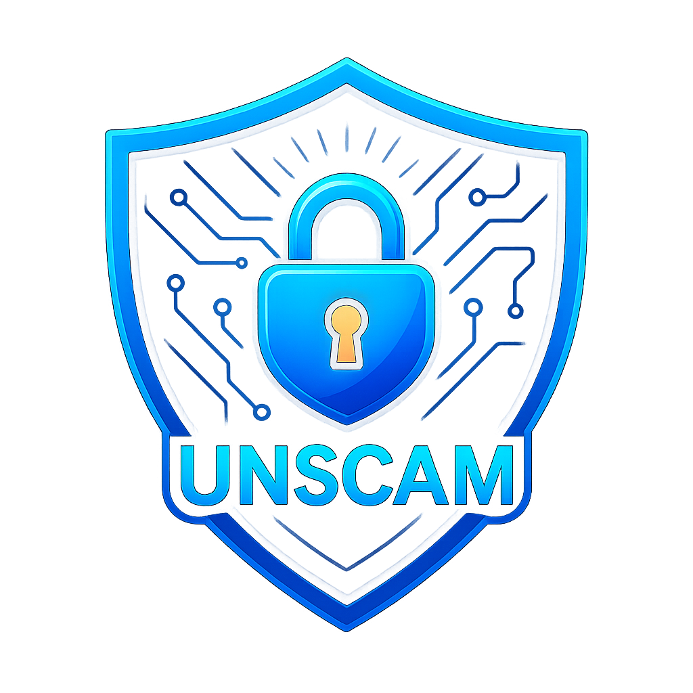

  

<h1 align="center">UNSCAM</h1>

  <strong>India is ready to fight Digital Arrest, Fraudsters and Mobile Scams.</strong>

  <strong>Citizen-first mobile scam protection</strong> 
  Clear warnings · Safer app access · Greater peace of mind

  🇮🇳 &nbsp; Designed for citizens in India &nbsp; | &nbsp; Android

---

## A safer phone begins with a safer decision

Today's fraud is not limited to a suspicious phone call. Scammers impersonate authorities, manufacture panic, distribute deceptive APKs, and attempt to turn an ordinary smartphone into an instrument of financial harm.

**UNSCAM** is a citizen-focused Android protection initiative developed to help people **recognise suspicious situations, review potentially risky applications, and respond with greater confidence.**

Our purpose is simple: **make meaningful mobile protection easier to understand and use.**

## Two flagship protection priorities

### 🛡️ Digital Arrest Prevention Focus — challenge fear, resist coercion

Fraudsters sometimes pose as police officers, investigators, or public authorities and attempt to pressure citizens through threats, urgency, secrecy, or demands for payment.

UNSCAM places special emphasis on **Digital Arrest scam awareness** and supported warning scenarios, helping citizens recognise danger signs and choose a safer response.

**A threatening call is not a lawful arrest. Do not transfer money, reveal credentials, or install software on a caller's instructions. Verify independently.**

### 🔒 App Internet Restriction — trust must be earned

A suspicious application should not receive unrestricted internet access merely because it has been installed.

UNSCAM's **Network Shield** provides citizen-controlled internet access restrictions for unapproved applications. Users can review an application, approve access when appropriate, or revoke that approval later.

**Block. Review. Decide.** The citizen stays in control.

---

## Protection features

| Protection area | What it means for citizens |
| --- | --- |
| **Digital Arrest awareness** | Safety guidance and warnings for supported high-pressure, authority-impersonation scam scenarios. |
| **Network Shield** | Restricts internet connectivity for applications without the required approval when protection is active. |
| **Code Red & App Review** | Brings potentially risky applications to the user's attention for an informed access decision. |
| **Automatic APK Shield** | Helps identify supported suspicious app and APK-related risk situations without requiring routine manual file selection. |
| **Fake eChallan / RTO / mParivahan warnings** | Flags supported transport-authority impersonation patterns that can be used to lure victims into fraudulent links or APKs. |
| **Suspicious links and messages** | Warns about supported scam indicators in the information available to the app. |
| **Call and payment safety awareness** | Provides supported risk warnings where suspicious calling and financial-activity signals are observable. |
| **Conversation-risk awareness** | Recognises supported warning patterns in permitted message observations; it does not read every private conversation. |
| **Age-oriented protection settings** | Simpler protection choices designed to reduce unnecessary complexity for different users. |
| **Alerts and Activity** | Clearer access to observed warnings and relevant protection activity. |
| **Offline User Manual** | A built-in, twelve-chapter guide that remains readable without an internet connection. |
| **App approval and recovery controls** | Review permitted apps, change access decisions, and stop Network Shield when needed. |

## Built around people, not technical jargon

**Easy to understand.** Protection states and warnings are designed to be meaningful to everyday users.

**Control when it matters.** App access decisions can be reviewed and changed by the citizen.

**Guidance even when offline.** The integrated User Manual explains the main protection screens, Code Red reviews, and practical troubleshooting.

**India-specific threat awareness.** Special attention is given to Digital Arrest pressure and impersonation themes encountered by Indian citizens.

---

## Recognise the warning signs

> **Someone claims you are under “Digital Arrest.”**
>
> **Someone demands immediate payment to avoid police action.**
>
> **Someone sends an APK disguised as a government notice.**
>
> **Someone insists that you keep the call secret or follow instructions without verification.**

**Pause. Verify. Protect yourself.** Do not surrender control of your phone or finances to someone using fear.

## Important safety information

UNSCAM is a protective aid, not a guarantee against every scam, malicious app, or unauthorised transaction. Some functions depend on Android permissions, device capabilities, active protection settings, and the information made available by other applications. Restrictions on unapproved apps do not establish that those apps are malicious, and an approval is not proof that an app is safe.

UNSCAM is an **independent citizen-safety initiative**, not an official government app, and this showcase does not imply government sponsorship, certification, or endorsement.

---

  

  <strong>MAKE IN INDIA · BUILT WITH A COMMITMENT TO CITIZEN SAFETY</strong>

  <em>UNSCAM — Protecting awareness. Empowering decisions.</em>

